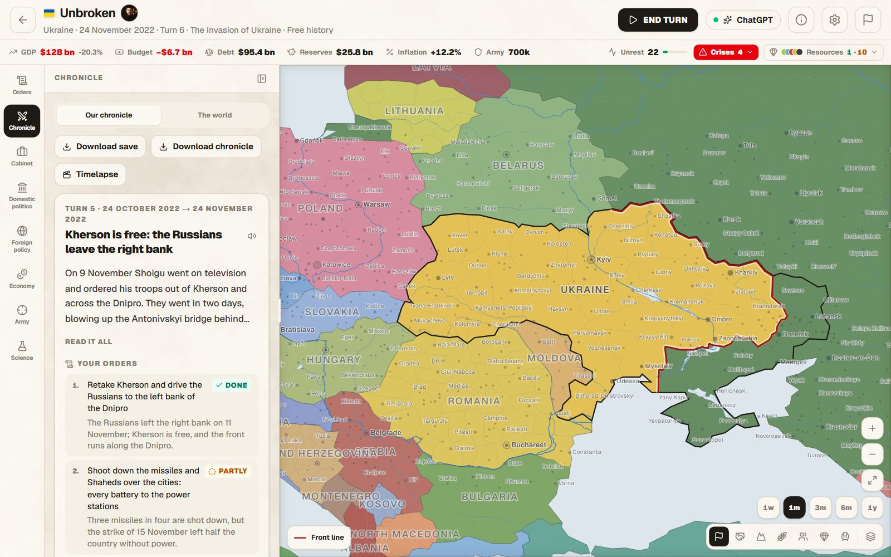
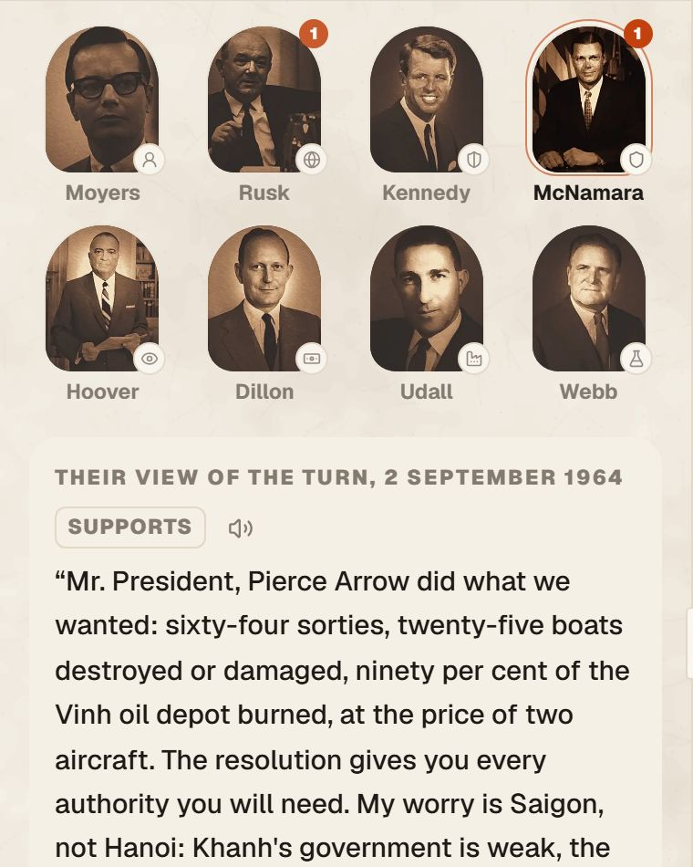
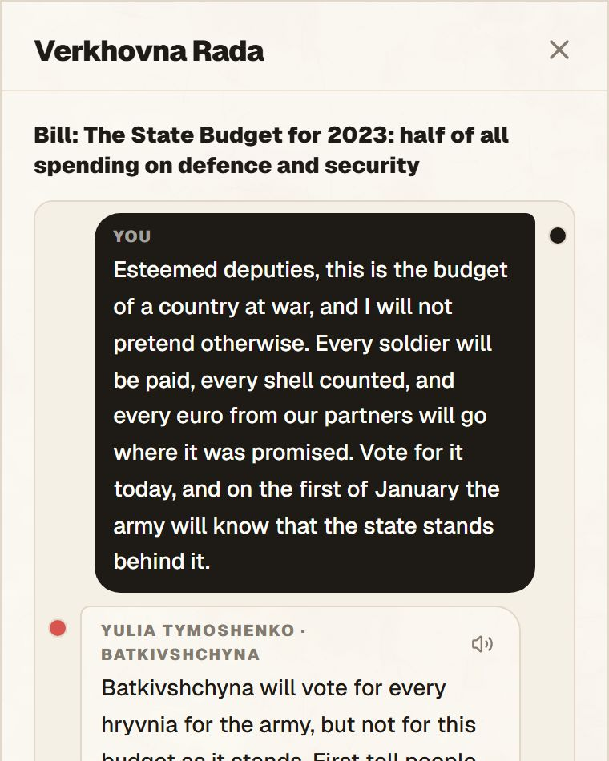
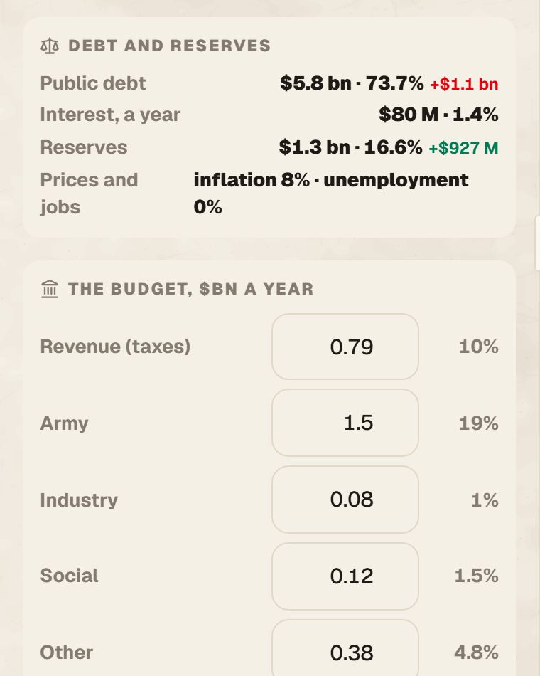
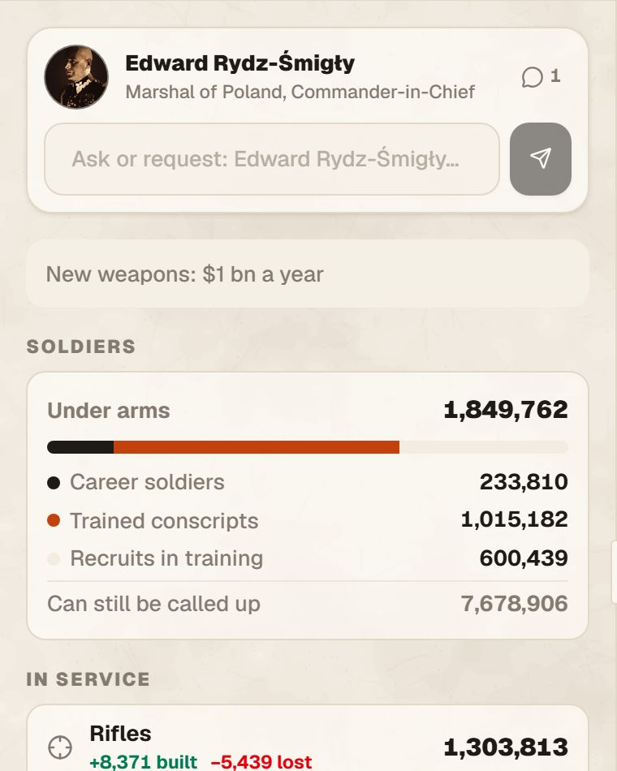
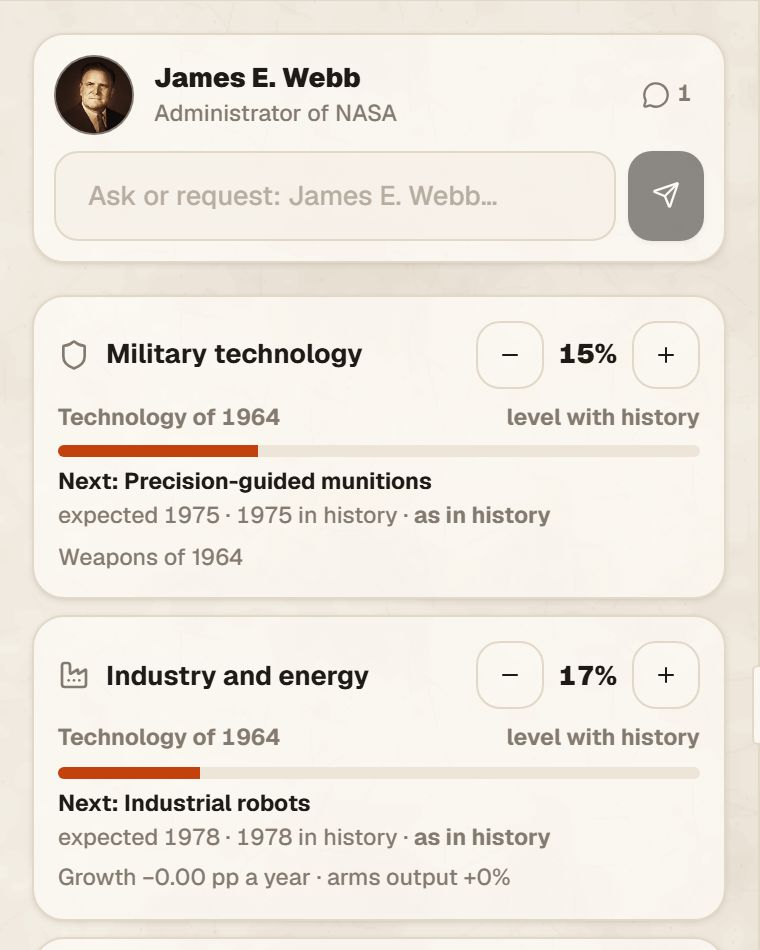
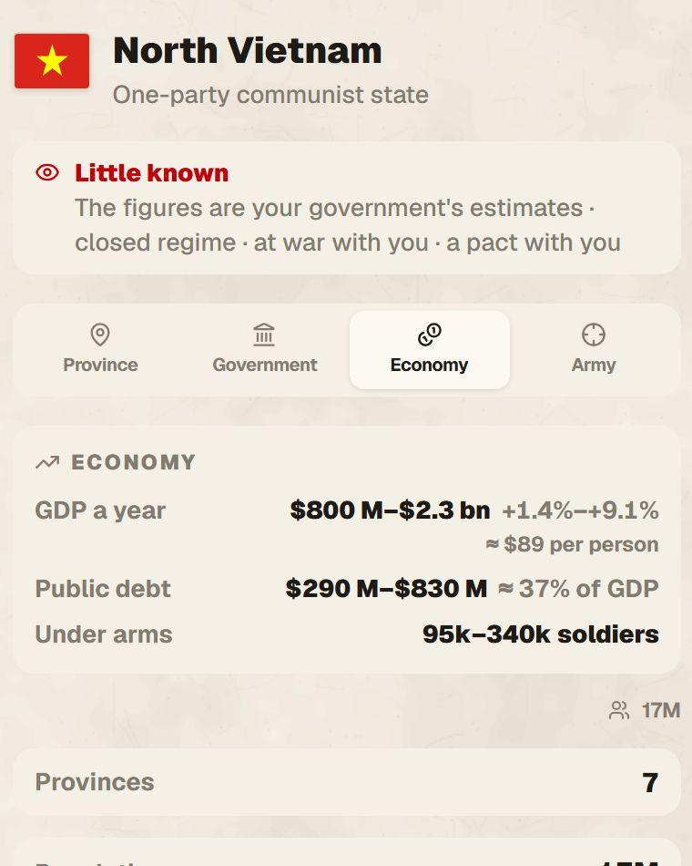
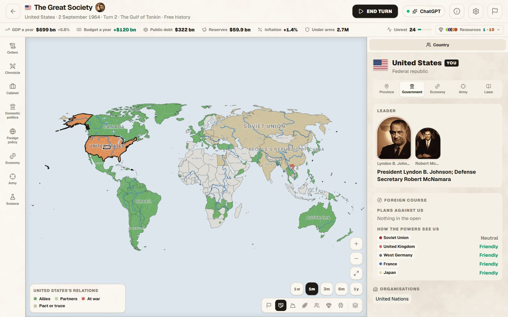
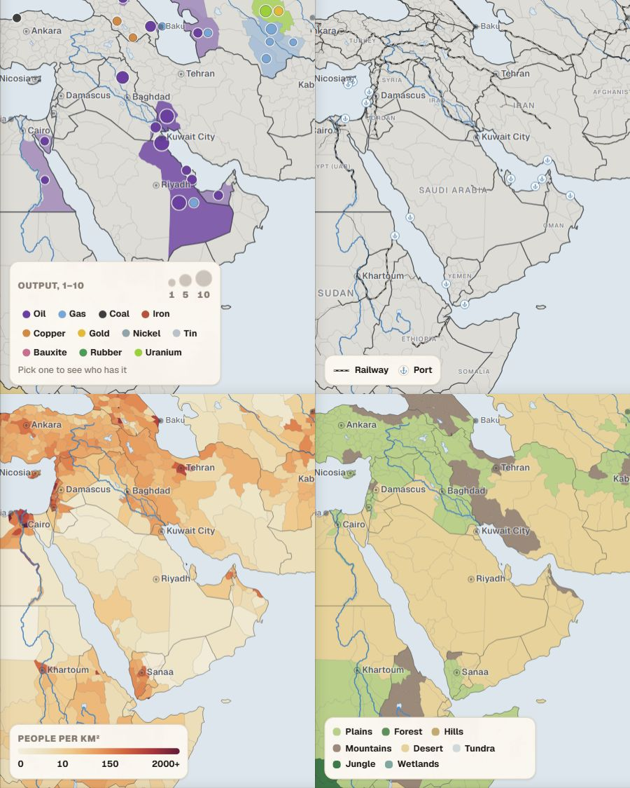
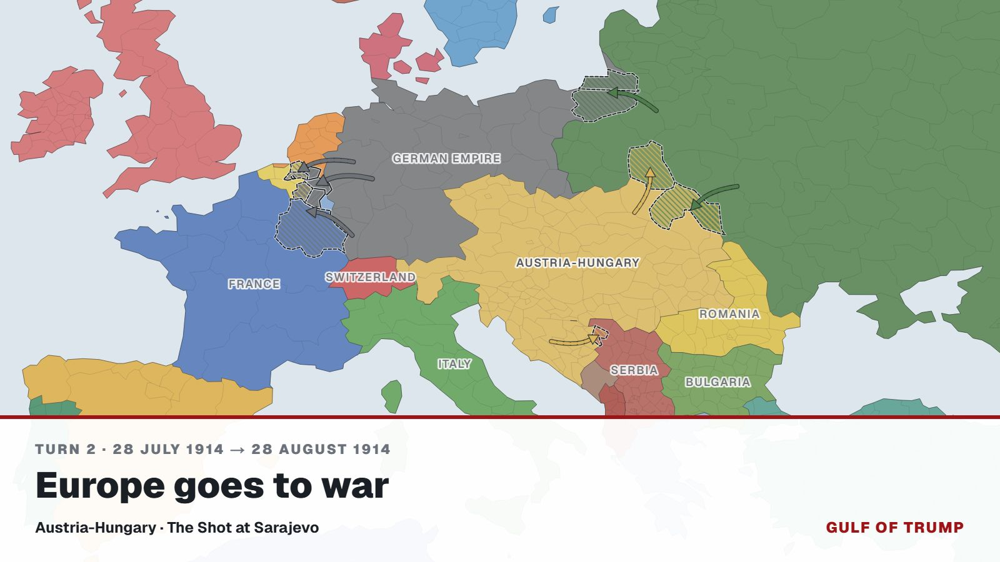

# Gulf of Trump

[](https://apps.microsoft.com/detail/9n07jx2chmw0)   

An alternate-history grand strategy game where a language model is the game
master. Pick a turning point of the 20th or 21st century, pick any country,
write your government's orders in plain language, and the model plays the
rest of the world — on **your own ChatGPT plan**, through OpenAI's official
*Sign in with ChatGPT*. No tokens to buy, no subscription to the game.

It is a free, open-source take on the idea behind
[Pax Historia](https://paxhistoria.co), which is a good game with a paywall in
front of every turn.



> **Beta. A sandbox: no goals and no victory screen — your country, your
> plan.** Eight dates; about 2,700 provinces with terrain, people, resources and
> railways, and fronts that run between the towns each side holds; an army
> counted piece by piece; an economy for every country with trade, sanctions
> and trade deals; seven directions of research racing history; eight
> ministries led by the real ministers of the day; parties, a parliament and
> the street; letters to any government, summits and sessions of the UN.
> Single player.

| | | |
|---|---|---|
|  |  |  |
| **Ministers of the day** in eight ministries, with interests of their own, who report after each turn | **Politics at home:** parties, elections, sittings where you speak for your bills | **An economy that keeps its books**, in money of the day |
|  |  |  |
| **An army counted piece by piece**, with its armies and fronts | **Research racing history** in seven directions | **Other countries as you know them:** wars, pacts and, under fog of war, estimates |

| | |
|---|---|
|  |  |
| **The world as any country sees it** on the diplomatic map | **Seven maps** of about 2,700 provinces |

Any turn can be shared as a picture, and the whole game replayed as a
timelapse video of its borders:



---

## Scenarios

| Date | Scenario | Start |
|------|----------|-------|
| **28 June 1914** | The Shot at Sarajevo | The Archduke is dead; the July Crisis has not started. The war can still be avoided. |
| **1 September 1939** | The Invasion of Poland | The Wehrmacht crosses the border; London and Paris have two days to decide. |
| **25 June 1950** | The Korean War | North Korean tanks cross the 38th parallel; the Soviets boycott the Security Council, Mao eyes Taiwan, France fights in Indochina. |
| **2 August 1964** | The Gulf of Tonkin | Torpedo boats attack the USS Maddox. The Viet Cong hold half the South's countryside, the Pathet Lao the Plain of Jars; Sukarno confronts Malaysia. |
| **19 August 1991** | The August Coup | Gorbachev is isolated in Foros, tanks are in Moscow; the USSR still exists. Every Soviet and Yugoslav republic is playable. |
| **24 March 1999** | NATO Bombs Yugoslavia | Rambouillet has failed; Allied Force begins without a UN mandate. Play Milošević, NATO, Russia, the KLA or Đukanović's Montenegro. |
| **16 January 2014** | Euromaidan | The eighth week of the Maidan; parliament has passed the "dictatorship laws". Yanukovych's police are loyal, the army wavers, the oligarchs wait. |
| **24 February 2022** | The Invasion of Ukraine | The full-scale invasion begins at dawn. |

Every country on the map is playable, plus the republics that hold no land
yet (play Yeltsin's Russia or Kravchuk's Ukraine inside the USSR and break out).
Interface in Russian, Ukrainian and English; the game master writes in the
language you play in.

---

## What is interesting in here

**The model narrates; the engine keeps the books.** A pure LLM game forgets
who owns what. Here the world is structured state — owner and holder of
every region, wars, alliances, leaders, every country's economy and army —
and the model answers each turn with a JSON outcome. [`sanitizeOutcome`](src/engine/outcome.ts)
drops every change that points at a region or country that does not exist,
clamps stat swings to ±15 and normalises new countries; [`applyOutcome`](src/engine/outcome.ts)
applies the rest as a pure function and writes what *actually* changed into
the chronicle. A bad answer gets one repair round with the parse error spelled
out before the turn fails ([`completeJson`](src/server/llm.ts)).

**Sign in with ChatGPT, implemented from the protocol.** OpenAI's DevKit is
under a noncommercial licence, so the client is written independently against
the published protocol: OIDC discovery, PKCE, dynamic client registration on a
one-shot loopback listener, ID-token verification with `jose`, refresh with
single-flight, revocation on sign-out, and the Responses API's streaming
contract (`store: false`, `stream: true`, success only on `response.completed`).
See [`src/server/chatgpt/`](src/server/chatgpt/) and [docs/ai-providers.md](docs/ai-providers.md).

**An economy that keeps its own books.** Every country has a GDP, a budget
(revenue; army, industry, social and other spending), debt, reserves,
inflation, unemployment and soldiers, started from each province's income
scaled back to the date ([`src/engine/economy.ts`](src/engine/economy.ts)).
The model proposes what a turn does to them — taxes raised, the army doubled,
a loan, a blockade — and the engine limits it (no budget line more than
triples in a turn, no more soldiers than there are people to call up), adds
deficits to debt, moves reserves with trade and empties the stores of a
country whose imports are cut: Germany in 1939 produces 0.8 of the oil it
needs 10 of.

**A government of people.** The head of state, the chief of staff and the
ministers have names, traits, a manner of speaking, ability, loyalty and a
faction. They answer in character from the same world state the game master
sees, carry standing directives and special operations, report every turn,
and suggest orders you add with one click. Replacing one opens a choice of
candidates with their pros and cons.

**Politics at home with a parliament.** Parties have leaders, support and
ideas that drift on three axes; the parliament is drawn seat by seat, and a
law, a confidence vote or a state of emergency needs the votes for it. Every
move at home (propaganda, censorship, an amnesty, a purge, a coalition, a
ban) says what it gives and what it risks. Protests climb from rallies to an
uprising; plots grow while ignored. Overthrown, you play on as the new
government.

**Trade deals from what a country really has.** Grain comes from farmland
(fertility, area and yields against mouths to feed), oil, gas, coal, metals
and uranium from the fields on the map. Each turn the market offers to buy
the country's surpluses and sell what it lacks — and arms in a war, never
from the enemy's side — in tonnes, barrels or cubic metres a year at a price
against the market. Signed deals pay, deliver and break
([`src/engine/deals.ts`](src/engine/deals.ts)).

**Occupation is not annexation, and a front is not a border.** Each province
has an *owner* and a *controller*. Wars occupy (hatched on the map); peace
returns occupied land unless the treaty annexes it; retaking your own land
is recorded as liberation. A province can be fought over: it is divided
among its towns, each side's colour covers the towns it holds, and one front
line runs around everything a side holds, whatever the province borders.
Whoever holds more than half holds the province. 2022 starts on the real
line of contact ([`src/engine/towns.ts`](src/engine/towns.ts)).

**~2,700 provinces, cut along each era's borders.** Provinces are Natural
Earth's first-level divisions (public domain), regrouped where they are tiny,
with names in Russian and Ukrainian. [`scripts/build-maps.mjs`](scripts/build-maps.mjs)
cuts them along the historical borders of 1914, 1938, 1994 and 2010
(`aourednik/historical-basemaps`, GPL-3.0): a province split by a border
becomes one province per side when each side holds a real share, so Poland in
1914 falls into its Russian, German and Austrian parts on its own. Terrain and
fertility come from Natural Earth's geography regions, sampled per province.
The source's owners are unreliable (1914 draws Romania with its 1920 borders),
so each scenario corrects them in code at the polygon, modern-country or
province level, and automated checks cover the partitions and corrections
that matter.

**A map of the right year, with amounts.** City names follow the start date
(Danzig, Königsberg and Lemberg in 1914, Leningrad and Stalingrad in 1939),
capitals are those of the time, and places appear as you zoom in — capitals
and the biggest cities first, provincial capitals close in, towns last. Eleven
strategic resources sit on the provinces that produced them with their output
over the years ([`scripts/resources.mjs`](scripts/resources.mjs),
written by hand): Persian Gulf oil turns up in the late 1930s and outgrows
Texas in the 1970s, the Amazon rubber boom ends in 1920. Every province has
its population on the start date and its railways; Natural Earth's network is
dated by hand, so the BAM is missing in 1939 and the Tibet line in 1991. Six
map modes — political, terrain, fertility, population, resources (all or one
at a time, with the top producers of the year) and transport — and overlays
for rivers, railways, ports, cities and province borders.

**A prompt that scales to a world of provinces.** The model does not get 2,700
province ids every turn. It gets the player's provinces in full, everything
across their borders, the front of every war (provinces of one side that touch
the other), occupied land and the countries — 3–12 thousand tokens. It may name
a province by id or by its exact name, or move a whole country at once; the
engine resolves both before anything is applied. Each order comes back with a
verdict — done, partly, failed — and a line on why.

**A local server that refuses everyone else.** The AI routes spend the plan of
whoever runs the server, so they answer only a loopback `Host` (which also
defeats DNS rebinding), refuse cross-site `Origin`/`Sec-Fetch-Site`, and accept
only JSON bodies. The dev server binds to `127.0.0.1`. Tokens live outside the
project folder, AES-256-GCM encrypted. Details and limits: [docs/security.md](docs/security.md).

---

## Running it

**Windows, the easy way:** get it from the
[Microsoft Store](https://apps.microsoft.com/detail/9n07jx2chmw0), then sign in
with ChatGPT in Settings. The Store version is signed by Microsoft and updated
by the Store.

**Windows, the installer:** download `GulfOfTrump-Setup-….exe` from the
[latest release](https://github.com/Darhaal/GulfOfTrump/releases/latest), install it and
sign in with ChatGPT in Settings. The app updates itself. It is not signed
yet, so Windows SmartScreen may warn about it: *More info* → *Run anyway*.
How the app is built: [desktop/README.md](desktop/README.md).

**From source** — requires **Node 22.12+** and a **ChatGPT account** (plan
usage for apps depends on your plan and OpenAI's current limits).

```bash
git clone https://github.com/Darhaal/GulfOfTrump.git
cd GulfOfTrump
npm install
npm run dev
```

Open **http://127.0.0.1:3000** → Settings → **Sign in with ChatGPT**. A browser
tab asks you to approve the app and its use of your plan; then pick a date.

Playing with friends: each person runs their own copy and signs in with their
own account. OpenAI's terms keep the sign-in and the requests on the player's
own machine, so one copy cannot be hosted for other people — see
[docs/ai-providers.md](docs/ai-providers.md).

**Optional — Google sign-in and cloud saves.** Create a Supabase project,
apply [`supabase/migrations/`](supabase/migrations/), enable the Google
provider, and put the URL and anon key in `.env.local`
([docs/getting-started.md](docs/getting-started.md) has the steps). Without
it the game runs as a guest and saves in the browser.

**Working on the interface without spending your plan:** `GOT_MOCK_AI=1` in
`.env.local` replaces the game master with an instant offline mock.

```bash
npm run lint
npm run typecheck
npm run build
npm run maps      # rebuild public/maps from the pinned source
```

---

## Tech stack

| Area | Choice |
|------|--------|
| Framework | Next.js 16 (App Router), React 19, TypeScript strict, React Compiler |
| Styling | Tailwind CSS 4 with light/dark theme tokens, Lucide icons |
| Map | d3-geo (Natural Earth projection) + TopoJSON, SVG, own pan/zoom/pinch and label placement; data from Natural Earth, aourednik/historical-basemaps and [GeoNames](https://www.geonames.org/) (CC BY 4.0) |
| Game master | ChatGPT via Sign in with ChatGPT → Responses API (streaming) |
| Validation | zod schemas for model output and saved state |
| Accounts & saves | Supabase — Auth (Google), Postgres with row-level security; IndexedDB in the browser otherwise |

---

## Security posture, honestly

- **What is protected:** your ChatGPT tokens never leave your machine except
  to OpenAI; the game's API routes answer only the local browser; cloud saves
  are readable and writable by their owner only (RLS on every table, no grants
  to `anon`, no `TRUNCATE`).
- **What is not:** the token file is encrypted with a key that sits next to it
  in `~/.gulf-of-trump`. That stops a copied folder or a stray `git add` from
  leaking it; it does not stop malware running as your user. An OS keychain
  is not done yet.
- **Cheating is not a concern by design.** You can edit your own save and
  your own orders; it is your game. There are no leaderboards.

---

## Documentation

| | |
|---|---|
| [Getting started](docs/getting-started.md) | Install, ChatGPT sign-in, Supabase and Google setup |
| [AI providers](docs/ai-providers.md) | Sign in with ChatGPT, terms, why Claude is not in yet |
| [Security](docs/security.md) | Threat model, guards, storage, accepted risks |
| [The public demo](docs/deploy.md) | Demo mode and the Vercel site |
| [Roadmap](ROADMAP.md) | What comes next, in order, without dates |

Status: [Changelog](CHANGELOG.md) · [Bugs and ideas](https://github.com/Darhaal/GulfOfTrump/issues/new/choose)

---

## License

The code is under the [GNU Affero General Public License v3.0](LICENSE)
(AGPL-3.0-only) from version 1.0.6; versions up to 1.0.5 were released under
MIT and stay so. Anyone may use, study and share it, and anyone who
distributes a changed version, or runs one for others over a network, must
publish its full source under the same licence. The map data in [`public/maps/`](public/maps/) is
derived from [aourednik/historical-basemaps](https://github.com/aourednik/historical-basemaps)
and stays under **GPL-3.0** ([details](public/maps/README.md)).

The name Gulf of Trump and its logo are trademarks of Artem Okhten and are not
covered by the code's licence: a fork must take another name
([TRADEMARKS.md](TRADEMARKS.md)).

ChatGPT is a trademark of OpenAI. This project is not affiliated with OpenAI,
Anthropic or Pax Historia.

A project by Artem Okhten · Okhten Group LLC.
